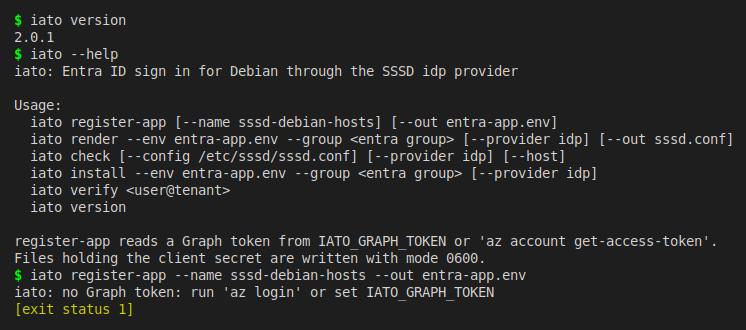
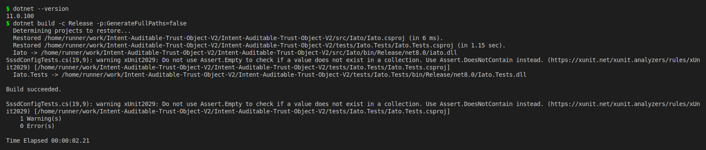
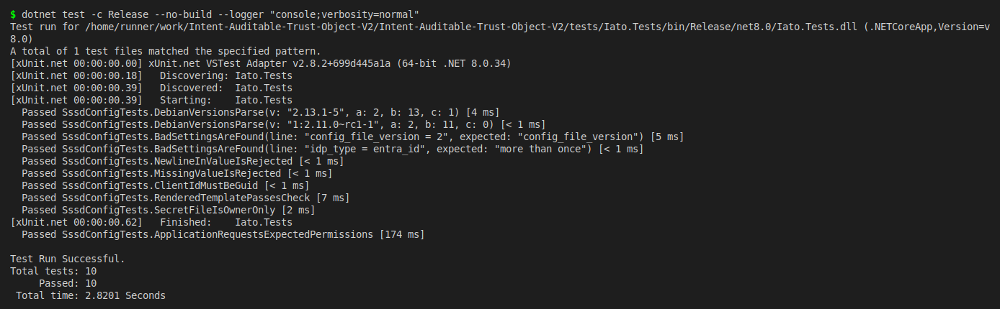
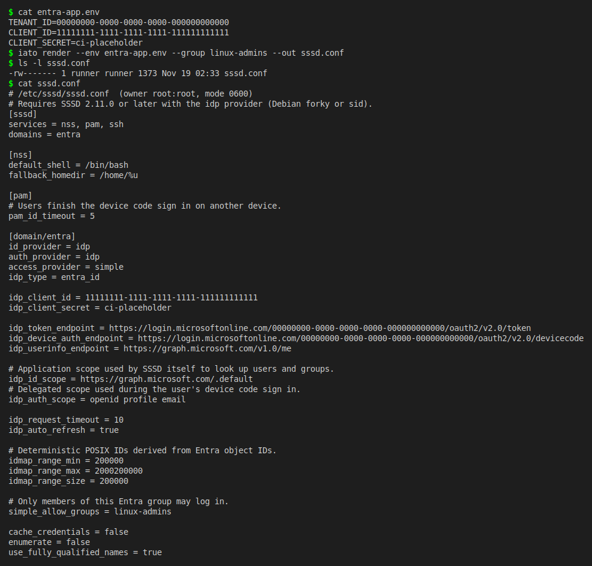
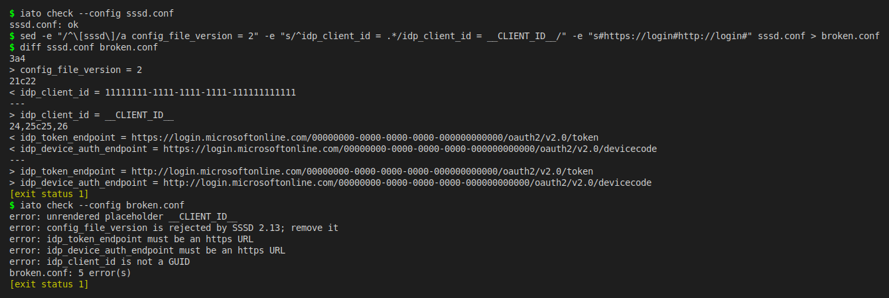
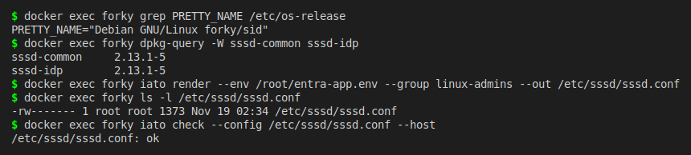
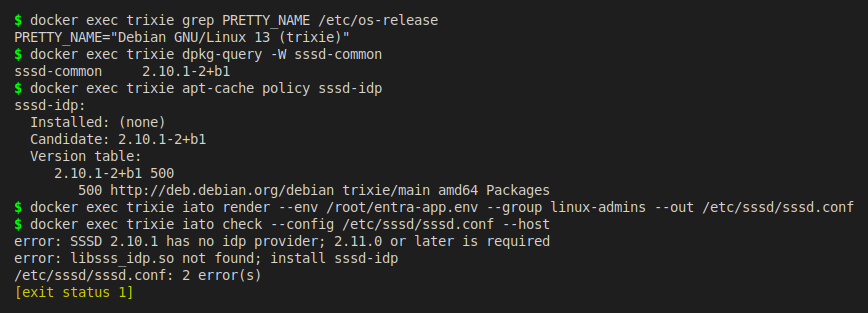

# Intent-Auditable Trust Object V2

This repository provides `iato`, a C# (.NET 8) command line tool that configures Debian hosts to authenticate Microsoft Entra ID users through the SSSD identity provider (`idp`) back end. SSSD reads users and groups from Microsoft Graph, signs users in with the OAuth 2.0 Device Authorization Grant (RFC 8628), and derives consistent POSIX UIDs and GIDs from Entra object IDs, so no ID mapping is managed by hand. It is not an identity provider, a directory service or a replacement for SSSD; it renders, checks and installs SSSD configuration and verifies the result.

The key words MUST, MUST NOT, SHALL, SHOULD and MAY in this document are to be interpreted as described in BCP 14 (RFC 2119 and RFC 8174).

## Contents

- [Key features](#key-features)
- [Scope](#scope)
- [Architecture](#architecture)
- [Repository layout](#repository-layout)
- [Requirements](#requirements)
- [Build](#build)
- [Usage](#usage)
- [Configuration](#configuration)
- [Verification and testing](#verification-and-testing)
- [Figures](#figures)
- [Security](#security)
- [License](#license)

## Key features

`iato` has four parts. Each one is a subcommand that runs against Microsoft Graph, a configuration file or a Debian host, and each states what checks it.

| # | Feature | What runs | Checked by |
|---|---|---|---|
| 1 | [Entra ID app registration](#1-entra-id-app-registration) | `iato register-app` against Microsoft Graph | xUnit test of the Graph request body; not run in CI, which has no tenant |
| 2 | [Rendering of `sssd.conf` for the `idp` domain](#2-rendering-of-sssdconf-for-the-idp-domain) | `iato render` from the embedded template | xUnit tests; `ci.yml` renders the file in Debian forky (Figures 4 and 6) |
| 3 | [Configuration and host checks](#3-configuration-and-host-checks) | `iato check`, `iato check --host` | xUnit tests; `ci.yml` runs `--host` against SSSD in Debian forky (Figures 5 to 7) |
| 4 | [Host installation and verification](#4-host-installation-and-verification) | `iato install`, `iato verify` on a Debian host | `iato verify` on a configured host; not covered by CI |

### 1. Entra ID app registration

- Creating the Entra ID app registration through Microsoft Graph (`iato register-app`).
- An Entra ID app registration gives SSSD application permissions to read users and group membership, and allows public client flows for device code sign in.
- Graph permissions requested: application `User.Read.All` and `GroupMember.Read.All`; delegated `openid`, `profile` and `email`. Admin consent is granted for both.
- The client secret is written to `entra-app.env` with mode 0600. The token is taken from `IATO_GRAPH_TOKEN` or `az account get-access-token`.

### 2. Rendering of `sssd.conf` for the `idp` domain

- Rendering `sssd.conf` for the `idp` domain (`iato render`).
- The template `sssd/sssd.conf` is compiled into the binary, so hosts need nothing else on disk.
- Missing or multi line values are rejected before any file is written, and the output file is created with mode 0600.

### 3. Configuration and host checks

- Checking `sssd.conf` for the `idp` domain (`iato check`): placeholders, duplicate keys, required `idp` settings, https endpoints, idmap range and `config_file_version`.
- `--host` also checks the installed SSSD version (2.11.0 or later), the presence of `libsss_idp.so` and the file mode.
- The checks do not depend on the `sssctl` rule set, which can lag new back ends.

### 4. Host installation and verification

- Installing and enabling SSSD, `pam_sss` and the sshd drop in on Debian hosts (`iato install`).
- Verifying that a user resolves and may log in (`iato verify`).
- `iato install` starts SSSD only after the configuration and host checks pass.

## Scope

Out of scope:

- Distributions other than Debian.
- SSSD versions earlier than 2.11.0, which have no `idp` provider.
- The OpenLDAP domain and Debian packaging, which are held on separate branches (see [Branches](#branches)).

Known limitations:

- The ID mapping can, in rare cases, assign the same ID to two objects; only the first one resolved is available.
- The client secret is the only credential type supported for this provider at present.
- On Debian 12 and 13, SSSD packages are taken from Debian forky through an apt pin rather than from the installed release.

Planned work (not implemented):

1. A certificate credential in place of the client secret, once SSSD supports one for the `idp` provider (see [Configuration](#configuration)).

## Architecture

### How it works

1. An Entra ID app registration gives SSSD application permissions to read users and group membership, and allows public client flows for device code sign in.
2. SSSD runs with `id_provider = idp` and `idp_type = entra_id`. `getent` and `id` resolve Entra users and groups.
3. At login, `pam_sss` shows a verification URL and code. The user signs in on any browser, Conditional Access and MFA apply, and SSSD completes the login once Entra confirms.
4. `access_provider = simple` limits logins to one Entra group.

### Components

```
 admin workstation                         Microsoft Entra ID
 -----------------                         ------------------
 iato register-app  ---- Graph v1.0 ---->  app registration, service principal,
   |                                       app role assignments, admin consent,
   v                                       client secret
 entra-app.env (0600)
   |
   v                    Debian host
 +---------------------------------------------------------------+
 | iato install / render / check --host                          |
 |   -> /etc/sssd/sssd.conf (root, 0600), [domain/entra]         |
 |   -> apt pin to forky on bookworm and trixie                  |
 |   -> pam-auth-update (sss, mkhomedir), sshd drop in           |
 |                                                               |
 | sssd (id_provider = idp) ---- token, Graph lookups ---------> | Entra ID, Graph
 | pam_sss <- sshd (keyboard-interactive)                        |
 |   device code prompt  ----- RFC 8628 device authorization --> | Entra ID
 | iato verify -> sssctl, getent, id                             |
 +---------------------------------------------------------------+
```

### References

- [sssd-idp(5)](https://manpages.debian.org/testing/sssd-common/sssd-idp.5.en.html)
- [SSSD 2.11.0 release notes](https://sssd.io/release-notes/sssd-2.11.0.html)
- [SSSD IdP introduction](https://sssd.io/docs/idp/idp-introduction.html)

## Repository layout

| Path | Purpose |
| --- | --- |
| `src/Iato/` | The CLI (.NET 8) |
| `tests/Iato.Tests/` | xUnit tests for rendering, checks and the Graph request |
| `sssd/sssd.conf` | Template for the `idp` domain |
| `apt/` | forky source and pin so only SSSD packages come from forky |
| `ssh/` | sshd drop in enabling keyboard-interactive for the device code prompt |
| `docs/screenshots/` | Figures used in this README and the text logs they were captured from |
| `.github/workflows/ci.yml` | Build, test, then `iato check --host` against SSSD in a Debian forky container |
| `.github/workflows/captures.yml` | Produces the figures in this README on an Xvfb display |

### Branches

| Branch | Holds |
| --- | --- |
| `main` | The `iato` CLI, the `idp` domain template, tests and CI |
| `openldap` | `main` plus an OpenLDAP domain (`iato render --provider ldap`) for hosts that must work offline from Entra ID or need LDAP binds |
| `release/2.x` | `main` plus Debian packaging and the release workflow; version tags are cut here |

### History

This repository was named `agent-q` until v2. Versions up to `v0.3.0` were Agent Q, a pull request reviewer on Cloudflare Workers and Supabase. That code remains at the `v0.3.0` tag and release. `v1.0.0` was the first release of the SSSD project.

## Requirements

| Item | Detail |
| --- | --- |
| SSSD | 2.11.0 or later MUST be installed. Debian 12 ships 2.8.2 and Debian 13 ships 2.10.1, so this repository pins SSSD packages from Debian forky (2.13). Debian forky and sid ship a suitable version as is. |
| Packages | `sssd`, `sssd-idp`, `libnss-sss`, `libpam-sss`, `sssd-tools` |
| Entra ID | Rights to create an app registration and grant admin consent |
| Graph permissions | Application: `User.Read.All`, `GroupMember.Read.All`. Delegated: `openid`, `profile`, `email` |
| Build | .NET 8 SDK, only when building from source |

The released binary is self contained, so hosts do not need a .NET runtime. Templates are compiled into it.

## Build

### Build from source

```console
dotnet test
dotnet publish src/Iato -c Release -r linux-x64 --self-contained -p:PublishSingleFile=true -o out
```

Figure 2 shows `dotnet build -c Release` and Figure 3 shows `dotnet test` on the CI runner.

### Install from a release

Releases are cut from the `release/2.x` branch. Each one attaches `iato_<version>_amd64.deb`, `iato_<version>_arm64.deb`, standalone `iato-linux-x64` and `iato-linux-arm64` binaries, a source tarball and `SHA256SUMS`. Downloads SHOULD be checked against `SHA256SUMS` before installation.

```console
V=2.0.0
curl -LO https://github.com/whatheheckisthis/Intent-Auditable-Trust-Object-V2/releases/download/v$V/iato_${V}_amd64.deb
curl -LO https://github.com/whatheheckisthis/Intent-Auditable-Trust-Object-V2/releases/download/v$V/SHA256SUMS
sha256sum --check --ignore-missing SHA256SUMS
sudo apt install ./iato_${V}_amd64.deb
```

## Usage

```console
iato register-app --name sssd-debian-hosts --out entra-app.env  # once per tenant
sudo iato install --env entra-app.env --group linux-admins      # on each host
iato verify alex@contoso.onmicrosoft.com
```

`iato register-app` runs once per tenant. `iato install` runs on each host and MUST run as root. On Debian 12 and 13, `iato install` adds the forky pin before installing SSSD.

| Command | Behaviour |
| --- | --- |
| `iato register-app` | Creates the Entra app registration through Microsoft Graph, grants admin consent, and writes `entra-app.env` (mode 0600). Uses `IATO_GRAPH_TOKEN` or `az account get-access-token`. |
| `iato render` | Renders `sssd.conf` from the embedded template. Rejects missing or multi line values. |
| `iato check` | Checks a config: placeholders, duplicate keys, required `idp` settings, https endpoints, idmap range, `config_file_version`. `--host` also checks the SSSD version, `libsss_idp.so` and the file mode. |
| `iato install` | Pins SSSD from forky where needed, installs packages, writes the config, enables `pam_sss` and the sshd drop in, and starts SSSD only after the checks pass. |
| `iato verify` | Runs `sssctl domain-status`, `getent`, `id` and `sssctl user-checks` for a user. |
| `iato version` | Prints the tool version. |

The built in help is shown in Figure 1.

### Walkthrough

The steps below follow one tenant and one host from app registration to an SSH sign in. Steps 2, 3 and 7 have captured figures from the CI runner. Steps 1, 4, 5 and 6 require a live Entra ID tenant or a Debian host running systemd, which CI does not provide, so no figure is published for them; see [Figures](#figures).

1. Register the Entra ID app once per tenant. The client secret is written to a file only the owner can read. Without a Graph token, `iato register-app` stops before any request is sent (Figure 1).
2. Render `sssd.conf` for the `idp` domain and check it before it reaches a host (Figures 4 and 5).
3. `iato check` stops a broken configuration: an unrendered placeholder, a key SSSD 2.13 rejects and endpoints that are not https (Figure 5).
4. Install on a Debian 13 host. SSSD packages are pinned from forky, and SSSD starts only after the host checks pass. Figure 7 shows the host check that fails on Debian 13 without the pin, and Figure 6 the same check passing against SSSD from forky.
5. Verify that an Entra ID user resolves to a POSIX account and passes the access check for the allowed group.
6. The user signs in over SSH. SSSD shows a device code, the user completes sign in on any browser with MFA and Conditional Access, and the session opens.
7. The unit tests cover rendering, checks and the Graph request (Figure 3).

## Configuration

- `sssd/sssd.conf` is the template for the `idp` domain. `iato render` and `iato install` fill it from `entra-app.env` and the `--group` value.
- `apt/` holds the forky source and pin so that only SSSD packages come from forky.
- `ssh/` holds the sshd drop in that enables keyboard-interactive authentication for the device code prompt.
- The client secret grants tenant wide read of users and group membership. It MUST be stored only in `/etc/sssd/sssd.conf` (root, 0600). A certificate credential SHOULD be preferred once SSSD supports one for this provider.
- `cache_credentials = false`: every login goes to Entra, so revoked accounts lose access at the next sign in.
- `idmap_range_*` values MUST be identical across hosts.

## Verification and testing

- `dotnet test` runs the xUnit tests in `tests/Iato.Tests/`, which cover rendering, checks and the Graph request.
- `.github/workflows/ci.yml` builds and tests on each push and pull request, then runs `iato check --host` against SSSD in a Debian forky container. Continuous integration does not cover Debian 12, Debian 13 or sid hosts.
- `.github/workflows/captures.yml` repeats the build and tests on an `ubuntu-24.04` runner and captures the figures in this README.
- On a configured host, `iato verify <user@tenant>` MAY be used to confirm that a user resolves and may log in.

### Test results

The [captures run](https://github.com/whatheheckisthis/Intent-Auditable-Trust-Object-V2/actions/runs/44444112722) of commit `57bda29` on an `ubuntu-24.04` runner reported the following (Figures 2 and 3; logs in [`docs/screenshots/02-dotnet-build.log`](docs/screenshots/02-dotnet-build.log) and [`docs/screenshots/03-dotnet-test.log`](docs/screenshots/03-dotnet-test.log)).

| Check | Result |
|---|---|
| `dotnet build -c Release` (SDK 11.0.100, target `net8.0`) | Build succeeded: 0 errors, 1 warning (xUnit analyzer `xUnit2029` in `tests/Iato.Tests/SssdConfigTests.cs`, line 19) |
| `dotnet test -c Release` (xUnit 2.8.2 VSTest adapter, .NET 8.0.34) | 10 tests in total, 10 passed, none failed |
| `iato check --host` in `debian:forky` (SSSD 2.13.1-5) | `/etc/sssd/sssd.conf: ok`, exit status 0 |
| `iato check --host` in `debian:trixie` (SSSD 2.10.1-2+b1) | 2 errors, exit status 1, as intended |

The ten tests, in the order the runner reported them:

| Test | Covers |
|---|---|
| `DebianVersionsParse("2.13.1-5")`, `DebianVersionsParse("1:2.11.0~rc1-1")` | Debian package version parsing used by `--host` |
| `BadSettingsAreFound("config_file_version = 2")`, `BadSettingsAreFound("idp_type = entra_id")` | Rejected key and duplicate key detection |
| `NewlineInValueIsRejected` | Multi line values cannot inject settings |
| `MissingValueIsRejected` | Rendering stops when a value is missing |
| `ClientIdMustBeGuid` | `idp_client_id` format check |
| `RenderedTemplatePassesCheck` | The rendered template has no placeholders and no errors |
| `SecretFileIsOwnerOnly` | Output files are created with mode 0600 |
| `ApplicationRequestsExpectedPermissions` | The Graph application body requests the two application roles and allows public client flows |

## Figures

All figures are produced by [`.github/workflows/captures.yml`](.github/workflows/captures.yml) on an `ubuntu-24.04` runner, run [44444112722](https://github.com/whatheheckisthis/Intent-Auditable-Trust-Object-V2/actions/runs/44444112722) of commit `57bda29`. Each figure is an `xterm` window on an Xvfb display running the commands it shows, captured with ImageMagick `import -window`; the only edit is cropping of empty terminal space. No figure is drawn by hand. The text that each terminal printed is kept beside the image as a `.log` file in [`docs/screenshots/`](docs/screenshots/). The Entra identifiers and the client secret are the same placeholders used by `ci.yml` (`00000000-...` tenant, `11111111-...` client, `ci-placeholder`), and no tenant is contacted. Select any figure to open it at full resolution.

| Figure | Subject | Tool | Source |
|---|---|---|---|
| 1 | `iato version`, `iato --help`, `iato register-app` without a Graph token | `iato` 2.0.1 | `src/Iato/Program.cs`, `src/Iato/EntraRegistrar.cs` |
| 2 | Release build | .NET SDK 11.0.100, MSBuild | `Iato.sln` |
| 3 | Unit tests | `dotnet test`, xUnit 2.9.2 | `tests/Iato.Tests/SssdConfigTests.cs` |
| 4 | Rendered `sssd.conf` for the `idp` domain | `iato render` | `sssd/sssd.conf`, `src/Iato/SssdConfig.cs` |
| 5 | Configuration check on a valid and a broken file | `iato check`, GNU sed, diff | `src/Iato/SssdConfig.cs` |
| 6 | Host check against SSSD 2.13.1 in Debian forky | `iato check --host`, Docker `debian:forky` | `src/Iato/HostSystem.cs` |
| 7 | Host check against SSSD 2.10.1 in Debian 13 | `iato check --host`, Docker `debian:trixie` | `src/Iato/HostSystem.cs` |

The following are not captured, because they need resources that CI does not have: `iato register-app` against a real tenant (it requires a Graph token with rights to create an app registration), `iato install` (it requires a Debian host running systemd), `iato verify` (it requires a running SSSD joined to a tenant), and the SSSD device code prompt at SSH login (it is printed by `pam_sss` after a live device authorization request to Entra ID). The Graph request body is covered by a unit test instead (Figure 3).

### Command line

<p align="center"><a href="docs/screenshots/01-cli-help.png"></a><br><sub><b>Figure 1.</b> <code>iato version</code> prints 2.0.1 and <code>iato --help</code> lists the six subcommands. <code>iato register-app</code> on a runner with no <code>IATO_GRAPH_TOKEN</code> and no Azure CLI sign in stops before any Graph request and exits with status 1.</sub></p>

### Build and tests

<p align="center"><a href="docs/screenshots/02-dotnet-build.png"></a><br><sub><b>Figure 2.</b> <code>dotnet build -c Release</code> restores and builds <code>Iato</code> and <code>Iato.Tests</code> for <code>net8.0</code> with SDK 11.0.100. The build succeeds with 0 errors and 1 warning, the xUnit analyzer rule <code>xUnit2029</code> in the test project.</sub></p>

<p align="center"><a href="docs/screenshots/03-dotnet-test.png"></a><br><sub><b>Figure 3.</b> <code>dotnet test -c Release</code> with the normal console logger lists each test. Total tests: 10; passed: 10.</sub></p>

### Configuration

<p align="center"><a href="docs/screenshots/04-render-sssd-conf.png"></a><br><sub><b>Figure 4.</b> <code>iato render</code> fills the embedded template from a placeholder <code>entra-app.env</code> and the group <code>linux-admins</code>. The output file is created with mode 0600 (<code>-rw-------</code>). The <code>[domain/entra]</code> section sets <code>id_provider = idp</code>, <code>idp_type = entra_id</code>, the tenant token and device authorization endpoints, the idmap range and <code>cache_credentials = false</code>.</sub></p>

<p align="center"><a href="docs/screenshots/05-check-config.png"></a><br><sub><b>Figure 5.</b> <code>iato check</code> reports the rendered file as ok. A copy is broken with <code>sed</code>: <code>config_file_version</code> is added, <code>idp_client_id</code> is replaced by a placeholder and two endpoints are changed to http; <code>diff</code> exits with status 1 because the files differ. <code>iato check</code> then reports 5 errors and exits with status 1.</sub></p>

### Host checks

<p align="center"><a href="docs/screenshots/06-host-check-forky.png"></a><br><sub><b>Figure 6.</b> In a <code>debian:forky</code> container with <code>sssd-common</code> and <code>sssd-idp</code> 2.13.1-5 installed, <code>iato render</code> writes <code>/etc/sssd/sssd.conf</code> as root with mode 0600, and <code>iato check --host</code> reports it as ok.</sub></p>

<p align="center"><a href="docs/screenshots/07-host-check-trixie.png"></a><br><sub><b>Figure 7.</b> In a <code>debian:trixie</code> (Debian 13) container, <code>sssd-common</code> is 2.10.1-2+b1 and the <code>sssd-idp</code> candidate is the same version; it is not installed. <code>iato check --host</code> reports that SSSD 2.10.1 has no <code>idp</code> provider and that <code>libsss_idp.so</code> is missing, and exits with status 1. This is the case that the forky pin in <code>iato install</code> addresses.</sub></p>

## Security

Security reporting and commit signature verification are described in [SECURITY.md](SECURITY.md); the maintainer signing key is published in [KEYS.asc](KEYS.asc).

## License

This project is licensed under the Apache License, Version 2.0. See [LICENSE](LICENSE).
